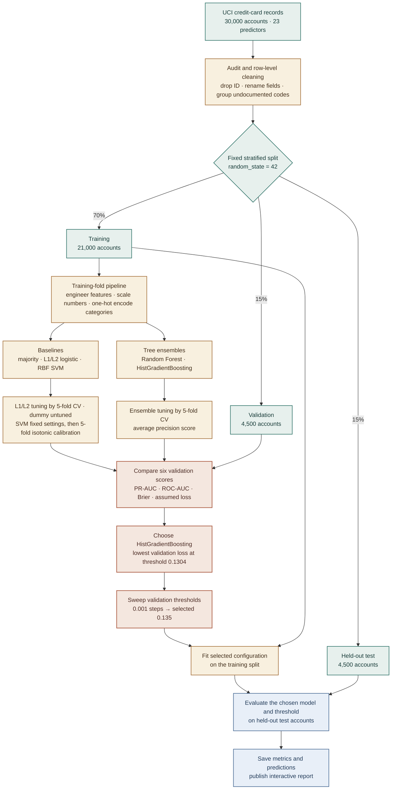

# Cost-sensitive credit default prediction

ES 335 final project by Tagalpallewar Abhishek Prashant (24110364) and Siddhantkumar Vinay Thute (24110373).

**Project website:** [Interactive research report](https://tagalpallewarabhishek.github.io/credit-default-prediction/) (public GitHub Pages site). The submitted site source is in [`docs/`](docs/); the older design is archived in [`archive/previous-website/`](archive/previous-website/).

**Repository:** https://github.com/TagalpallewarAbhishek/credit-default-prediction

## Question and data

Can account and payment history predict next-month default, and which probability threshold minimizes loss under different error costs? One row is one client account. The target is next-month default payment, not whether a new loan should be approved.

The [UCI Default of Credit Card Clients dataset](https://archive.ics.uci.edu/dataset/350/default+of+credit+card+clients) has 30,000 Taiwan accounts, 23 predictors, and one binary target. It contains credit limits, demographics, six months of repayment statuses, bills, and payments. Exactly 6,636 accounts (22.12%) have the default label. The downloaded source has no missing cells. Undocumented `EDUCATION` and `MARRIAGE` codes and negative bill amounts need explicit handling; the choices appear below.

## Project pipeline

The diagram shows where each split is used. The test accounts enter only after model and threshold selection.



## Setup and run

Use Python 3.11 or newer. Run commands from the repository root. The CSV data and saved outputs are already included; run the commands below to regenerate them. The activation command shown is for PowerShell (`source .venv/bin/activate` on macOS/Linux).

```powershell
python -m venv .venv
.venv\Scripts\Activate.ps1
python -m pip install -r requirements.txt
python src/01_inspect_data.py
python src/02_split_data.py
python src/train_baselines.py
python src/analyze_baselines.py
python src/calibrate_and_optimize.py
python src/train_ensembles.py
python src/cost_optimizer.py
python src/evaluate_all_models.py
python docs/generate_chart_data.py
python -m http.server 8000 --directory docs
```

Open `http://localhost:8000/`. `01_inspect_data.py` downloads the UCI `.xls` file and saves `data/raw_credit_default.csv`. If the download URL is unavailable, use the checked-in CSV or download the UCI file and convert it to CSV with its second spreadsheet row as headers (`header=1`). The split script exports `data/train.csv`, `data/val.csv`, and `data/test.csv`. The walkthrough is in [`notebooks/01_end_to_end_walkthrough.ipynb`](notebooks/01_end_to_end_walkthrough.ipynb); it reads saved outputs. A local notebook editor such as JupyterLab is optional and is not part of `requirements.txt`.

The fixed stratified split is 70/15/15 with `random_state=42`; stratification keeps the default rate similar across splits and the seed makes them reproducible. The script drops `ID` because it is an identifier, renames the target to `TARGET` and `PAY_0` to `PAY_1`, groups undocumented education and marriage codes as “other,” and retains negative bill balances rather than treating them as missing. The preprocessor adds credit-utilization and payment-to-bill ratios, delinquency severity/frequency, and debt trend to summarize account behavior. Numeric scaling puts differently sized variables on a comparable scale; one-hot encoding avoids assigning an artificial order to demographic categories. Both learned transformations are fitted within training folds, so validation and test rows do not determine them. The source data's 22.12% default rate makes class-sensitive metrics important.

## Results and verification

[`results/metrics_summary.csv`](results/metrics_summary.csv) and [`results/val_leaderboard.csv`](results/val_leaderboard.csv) compare all six models on validation. [`results/ensemble_val_metrics.csv`](results/ensemble_val_metrics.csv) records ensemble settings and five-fold training CV scores; [`results/baseline_val_metrics.csv`](results/baseline_val_metrics.csv) and [`results/calibration_metrics.csv`](results/calibration_metrics.csv) record the baseline and calibration experiments. The matching `.npz` files retain validation probabilities. [`results/test_metrics.json`](results/test_metrics.json) records the reported held-out result. [`results/test_predictions.json`](results/test_predictions.json) holds labels and probabilities for the descriptive test slider. [`docs/generate_chart_data.py`](docs/generate_chart_data.py) bundles those results into `docs/assets/data.js`. Plots, including [`results/model_loss_comparison.png`](results/model_loss_comparison.png), and the illustration prompt are also in the repository.

The validation comparison uses **assumed** costs of $10,000 per missed default (false negative) and $1,500 per false alarm (false positive). Their ratio gives a theoretical threshold of `1500 / (10000 + 1500) = 0.1304` if probabilities are calibrated and these costs apply. These dollar values are not observed losses in the dataset.

| Model | Validation PR-AUC | ROC-AUC | Brier ↓ | Assumed loss at 0.1304 ↓ |
| --- | ---: | ---: | ---: | ---: |
| HistGradientBoosting | 0.5526 | 0.7800 | 0.1356 | $4,187,500 |
| Random Forest | 0.5527 | 0.7771 | 0.1363 | $4,235,500 |
| Ridge logistic regression (L2) | 0.5099 | 0.7483 | 0.1415 | $4,652,500 |
| RBF SVM (isotonic calibrated) | 0.5036 | 0.7314 | 0.1420 | $4,747,500 |
| Lasso logistic regression (L1) | 0.5101 | 0.7382 | 0.1421 | $4,905,000 |
| Majority dummy | 0.2211 | 0.5000 | 0.2211 | $9,950,000 |

PR-AUC here is scikit-learn's **average precision**; higher is better. ROC-AUC measures ranking across both classes; higher is better. Brier measures probability error; lower is better. Ridge and Lasso regularization and both ensemble grids used five-fold training cross-validation. The SVM used fixed settings and was later isotonic calibrated with five training folds; the majority dummy was untuned. The selected ensemble settings were **15 maximum leaf nodes and learning rate 0.05** for HistGradientBoosting (CV PR-AUC 0.5656), and **maximum depth 8 and minimum leaf size 2** for Random Forest (CV PR-AUC 0.5633).

Random Forest's validation PR-AUC is marginally higher, but HistGradientBoosting has the lowest assumed validation loss at the common 0.1304 threshold, as well as higher ROC-AUC and lower Brier. That specified cost rule selected HistGradientBoosting. A 0.001-step sweep of its **validation** probabilities then selected threshold **0.135**. The chosen settings were fitted on the training split before the reported test evaluation; test labels did not choose the model or threshold.

On 4,500 test accounts, the selected model achieved PR-AUC 0.5596, ROC-AUC 0.7798, and Brier 0.1348. At 0.135, it missed **171** defaults and falsely flagged **1,686** non-defaults. Under the assumed costs, test-sample loss was **$4,239,000**, versus **$6,677,000** at threshold 0.50: a $2,438,000 scenario difference, **not observed savings**. These are aggregate error counts; the data do not establish why particular accounts were misclassified or whether a real intervention would help them.

## Team division & walkthrough

- **Tagalpallewar Abhishek Prashant (24110364):** Data audit and cleaning, fixed 70/15/15 stratified split (`src/01_inspect_data.py`, `src/02_split_data.py`), leak-free feature engineering pipeline (`src/preprocessing.py`), linear and kernel baselines (`src/train_baselines.py`), EDA/Lasso/error archetype analysis (`src/analyze_baselines.py`), probability calibration (`src/calibrate_and_optimize.py`), and end-to-end walkthrough notebook (`notebooks/01_end_to_end_walkthrough.ipynb`).
- **Siddhantkumar Vinay Thute (24110373):** Tree-based ensembles (`src/train_ensembles.py`), validation cost-curve threshold optimization and held-out test evaluation (`src/cost_optimizer.py`), and the static GitHub Pages report with interactive charts (`docs/`).

## Publish with GitHub Actions

The workflow in [`.github/workflows/deploy-pages.yml`](.github/workflows/deploy-pages.yml) uploads `docs/` and deploys it on pushes to `main` that change the site. GitHub Pages is already enabled with **GitHub Actions** as its source. To verify or redeploy:

1. Open the repository's **Settings → Pages** and confirm **Source: GitHub Actions**.
2. Open **Actions → Deploy website to GitHub Pages** and check the latest run. To redeploy, choose **Run workflow** on `main`.
3. Open the URL shown in **Settings → Pages** in a private browser window.

The canonical URL is `https://tagalpallewarabhishek.github.io/credit-default-prediction/`. The owner needs admin or maintainer permission to change the Pages source.

## Limitations

The data describe Taiwan accounts in 2005. The dataset does not include actual loss amounts, recovery, intervention outcomes, or current populations. The costs are assumptions. Sex and marital status raise fairness questions requiring separate checks before any operational use.

## AI-use disclosure

Google Gemini and OpenAI Codex/ChatGPT assisted with Python pipeline scaffolding, diagnostic plotting scripts, static website layout/styling, and the original halftone hero illustration in `docs/assets/hero-ledger.webp` (generated via built-in ImageGen; prompt saved in `docs/assets/hero-ledger.prompt.txt`). The published numeric claims and charts were checked against the source code, saved probabilities, and result files. The authors remain responsible for the final submission.

The illustration was made with the built-in ImageGen tool. Its [exact prompt](docs/assets/hero-ledger.prompt.txt) is saved with the asset.

The website's visual direction was inspired by the [GoShuin — Every stamp, a memory](https://www.awwwards.com/inspiration/desktop-goshuin-every-stamp-a-memory) example. Its artwork and interface assets were not reused.

## Citations

- Yeh, I.-C. (2009). [Default of Credit Card Clients](https://archive.ics.uci.edu/dataset/350/default+of+credit+card+clients). UCI Machine Learning Repository. DOI: [10.24432/C55S3H](https://doi.org/10.24432/C55S3H).
- Pedregosa, F. et al. (2011). [Scikit-learn: Machine Learning in Python](https://jmlr.org/papers/v12/pedregosa11a.html). *Journal of Machine Learning Research*, 12, 2825–2830.
